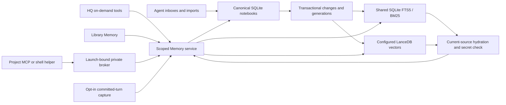

# Shared Memory architecture and qualification

HQ, projects and specialists use one admission and retrieval service. The operator guide is
[Shared memory](site/guide/memory.md); the load-bearing rules and regression tests are in
[the shared service invariant](invariants/shared-memory.md) and
[the project launch/file contract](invariants/project-memory.md). Implementation tracking: #2036.

## Store and retrieval

Per-notebook SQLite remains the authority. This preserves existing receipts, generations,
quarantine, imports, clears, filesystem locks, launch inboxes and Markdown projections. A physical
store consolidation would add migration and rollback risk without improving the measured query
path. Consolidation happens at the service, admission, lifecycle and retrieval boundaries.



The source store layout remains `<memory>/<project-id>/state.db`, with specialist scopes named
`<project-id>~<specialist-id>`. HQ uses the reserved `_hq` scope, without creating a project.
`.search/state.db` owns derived chunks, one full-text document per note, FTS5/BM25 ranking,
cursors and persistent purge work;
`.search/lance/` stores only vectors and their source identities. Search fuses independent lexical
and cosine rankings with reciprocal-rank fusion. Common English question grammar does not give
every note a lexical vote. No universal vector relevance threshold is assumed across encoders.

An index hit is a candidate, not a readable note. Every result is reauthorized and hydrated from
its current notebook under the current secret check, comparing revision, generation and actual
content digest. Deleted projects, changed sources, forgotten notes and newly registered secrets
therefore win before indexing catches up. Search never scans the corpus as an unavailable-index
fallback. Metadata discovery, search excerpts and authoritative reads are bounded; HQ's turn
budget is 8,000 characters and its references cannot be reused by another turn.

Keyword search never imports Arrow or Lance. Semantic search uses an independently configured
OpenAI-compatible embeddings endpoint, with no bundled encoder or model download. Keys are
encrypted and inventoried using the existing secret machinery. The HTTP adapter pins vetted DNS,
keeps TLS/Host/SNI, disallows redirects and ambient proxies, bounds replies and rejects dimension
drift. A body generator checks the current inventory and active connection/source identities
after connection, immediately before releasing request bytes. Already-sent bytes and text in
earlier model messages cannot be recalled by a later deletion.

Semantic queries reuse a native connection pinned to the derived directory's identity. Each
read still checks for other writers' commits, and purge completion closes the cached session.
Keyword and ANN ranking run independently with one bounded helper thread; the lexical helper
owns its SQLite connection. Eligible notes whose revision/generation/digest remain unchanged keep their
vectors across inventory rechecks. Pending vector deletions are batched before acknowledgment.
A model/endpoint-only save changes the embedding generation without rechecking source projections;
key replacement/clear keeps the full secret-registration fence and recheck.

## Capture, retention and correction

Explicit remember requests and optional capture save verbatim operator assertions with source
quotes. Existing HQ titles are not overwritten silently; corrections and forget requests use
the existing confirmation-card machinery and compare the revision originally read. Automatic
capture starts off and admits at most three candidates from a successful committed operator
turn. It ignores history without a committed capture intent, failed/discarded drafts, modified
or withheld source text, questions, quoted instructions and transient progress.

The durable handoff is the final JSONL `done` record, with source HMAC digest and capture/scope
revisions. Normal completion queues that committed intent immediately. A bounded reconciler
recovers an interrupted handoff. A candidate batch is persisted before admission; the note and
source receipt commit together before queue acknowledgment. Policy changes, clear, source
deletion and forget are checked again at admission. Forget blocks new extraction from the old
source turn even when the extractor changes its title or quoted span.

Admitted notes pin their source conversation past routine HQ history expiry (30 days or 50
conversations). This makes memory durable without weakening the explicit source-deletion rule.
Deleting that conversation still removes its derived notes. Forgetting the last active note
releases the pin; retention may then remove the old chat. Pending extraction alone pins nothing.

Authoritative recall exclusion is immediate. Derived text/vectors and retired generations have
persisted physical purge work, with retries within five minutes and a 24 operating hour deadline.
Health exposes pending age, safe error codes and overdue maintenance. Shared/exclusive kernel
reader leases protect zero-age Lance cleanup, FTS optimization, secure page deletion and WAL
truncation (VACUUM only when the derived index is empty). Lance cleanup explicitly materializes
even sparse deletions, removes abandoned transaction files and verifies no masked rows or old
versions remain before acknowledging completion. Disabling semantic search removes the derived
vectors while preserving source notes and keyword recall. Backups, exports,
already-written chat copies and SSD forensic recovery are outside that erasure claim.

## Compatibility and platform limits

Project switches remain opt-in and affect new processes. Existing running launches keep their
access; archive/runtime cleanup revokes a broker binding. New MCP read/search and
`agent-sessions memory search|read` share the service. Pip installs also expose `battlelab-memory`.
The two/four memory environment variables, inbox writes, wire tool names and Markdown projections
stay compatible. Already-running old-release MCP processes keep their file readers until restart.
The new MCP reader reports unavailable when its broker is unavailable; it does not silently scan.
The broker uses the Linux runtime's peer credentials and launch liveness checks. It does not add
tenant isolation to BattleLab's existing single-admin, same-UID trust model.

Native dependencies are pinned at LanceDB 0.41.0 and Arrow 26.0.1. Linux x86-64 installs
`lancedb-compat`, whose baseline is x86-64-v2, rather than the standard Haswell/AVX2 build. The
runtime checks the applicable CPU flags before importing native code. Published wheels also
cover Linux aarch64 and Apple Silicon (Arrow requires macOS 12+). Intel macOS has no LanceDB
0.41.0 wheel and keeps indexed keyword retrieval. Linux native wheels require glibc 2.28+.
The native wheel payload on the tested Python 3.13 Linux host is about 126 MiB before transitive
dependencies/unpacking. Keyword-only operation incurs disk installation cost on supported native
platforms but does not load the vector runtime. The actual runtime qualification is Linux x86-64;
ARM, macOS, pre-v2 CPUs and other filesystems are not claimed runtime-tested here.

Platform evidence: [LanceDB Python installation requirements](https://github.com/lancedb/lancedb/blob/main/python/README.md),
[compatibility package metadata](https://pypi.org/pypi/lancedb-compat/0.41.0/json),
[LanceDB wheel metadata](https://pypi.org/pypi/lancedb/0.41.0/json),
[Arrow wheel metadata](https://pypi.org/pypi/pyarrow/26.0.1/json).

## Upgrade, backup and rollback

Source format 2 adds metadata, receipts, revisions, job state and transactional change triggers;
the existing notes table and files retain their format. Source migrations occur only on writers,
and a future source format is refused before mutation. The derived format is independently
versioned and rebuildable. No agent's native memory is changed or disabled by this upgrade.

Back up canonical notebook SQLite databases with SQLite's backup API, including receipts and
tombstones, and retain the corresponding project catalog, HQ source conversations and encryption
key/settings. A Markdown export is a read view, not a recoverable state backup. For a consistent
multi-store snapshot, quiesce app writers in an operator-approved maintenance window; copying
live WAL databases as ordinary files is insufficient. The derived search directory can be
excluded. Restore a consistent snapshot and rebuild the derived index. An older external backup
has its own retention and can contain facts deleted after it was taken.

Rollback does not stamp source schemas down or discard data. Stop capture/embedding work before
switching releases, retain the new source and configuration backup, and use the existing release
rollback mechanism. Older releases retain their project/file contract but have no HQ notebook or
new secret-inventory integration; avoid new memory admissions until returning to the compatible
build. Rebuild only the app-owned derived cache when required. Never delete notebook stores or
host/workspace state to repair an index.

## Reproducing qualification

`scripts/qualify_memory.py` refuses an existing fixture root, pins isolated store paths, and uses
only synthetic content. It constrains the process to two logical CPUs. Run each mode with a new
private directory:

```bash
.venv/bin/python scripts/qualify_memory.py --mode service --rows 100000 --root /tmp/memory-service-new
.venv/bin/python scripts/qualify_memory.py --mode service --rows 100000 --note-chars 4600 --root /tmp/memory-chunks-new
.venv/bin/python scripts/qualify_memory.py --mode hybrid --rows 100000 --root /tmp/memory-hybrid-new
.venv/bin/python scripts/qualify_memory.py --mode native --rows 100000 --root /tmp/memory-native-new
```

Semantic quality uses the self-authored, published
[50-note / 100-query fixture](../tests/fixtures/memory-semantic.json). Its exact-title and
paraphrase queries each identify one relevant note. For this opt-in qualification only, install
FastEmbed separately and obtain the Apache-2.0 MiniLM model cache. The product does neither.
Use `--mode semantic --model-cache <existing-cache> --root <new-root>`; model revision is recorded
in the result. It runs the actual HTTP embeddings adapter and authoritative shared service.
Optionally add `--ai-config <saved-prefs> --chat-model <available-model>` to record six real-model
abstention answers against unrelated hybrid neighbours, making bounded synthetic chat calls.

Capture evaluation uses the published [24-case fixture](../tests/fixtures/memory-capture.json).
`--mode capture --ai-config <saved-prefs> --chat-model <available-model> --root <new-root>` makes
bounded paid synthetic calls through the saved origin's existing egress acknowledgment and sole
chat transport. The credential remains in memory only; it is never copied to the fixture or
report. It changes no operator setting. This evaluates selection and verbatim provenance on one
model/run, not protection against every possible injection.

The [qualification report and raw results](memory-qualification/README.md) record the backend
choice, installation cost, runtime limits, upgrade copies, capture and abstention checks.
On the two-CPU Xeon E5-4660 v4 Linux fixture, 100,000 notes measured global warm p95 **222 ms**
(120-character bodies) and **230 ms** (4,600-character bodies / 300,000 chunks). Four simultaneous
broad readers took 874–913 ms p95. The separate real-encoder 100-query fixture achieved
Recall@10 **0.93**, including paraphrases, at 97 ms p95 including local query embedding and HTTP.
The separate 100,000-note complete hybrid service run measures **230 ms global / 51 ms scoped**
p95 excluding its synthetic query-vector HTTP request. It uses precomputed fixture vectors,
so it does not measure a real encoder's relevance or large-corpus embedding throughput.
These are bounded qualification measurements, not a blanket latency or relevance guarantee.
